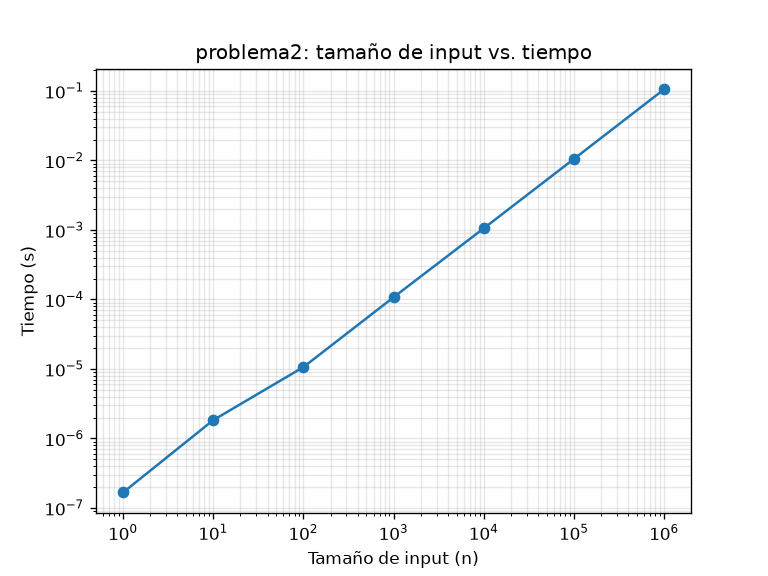
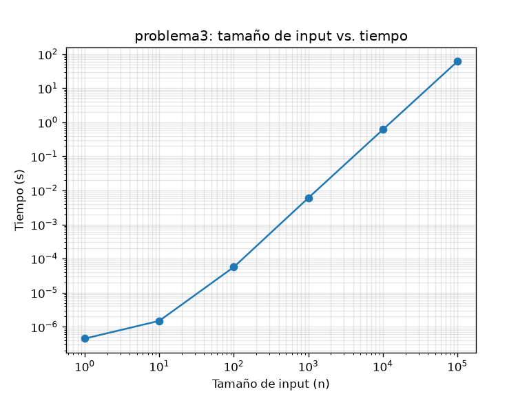

# Laboratorio 8 - Teoría de la Computación

Análisis de complejidad y profiling de tres programas.

**Video:** [enlace a YouTube](PEGAR_AQUI_EL_ENLACE)

## Estructura

```
├── medicion.py        # funciones para medir tiempo, guardar CSV, graficar y hacer profiling
├── problema1.py
├── problema2.py
├── problema3.py
├── requirements.txt
├── resultados/        # tablas (.csv), gráficas (.png) y salidas de cProfile (.txt)
└── respuestas_pdf/    # partes teóricas (parte a de P1-P3, P4 y P5)
```

## Cómo ejecutar

Requiere Python 3.10 o superior.

```bash
python -m venv venv
# Windows: venv\Scripts\activate
# Linux/Mac: source venv/bin/activate
pip install -r requirements.txt

python problema1.py
python problema2.py
python problema3.py
```

Cada script imprime la tabla en consola y guarda en `resultados/` el CSV, la gráfica y el reporte de cProfile.

Tiempos aproximados: problema 1 unos 6 s, problema 2 menos de 1 s, problema 3 alrededor de 1 minuto (por n = 100000).

## Decisiones tomadas

- **Lenguaje:** Python, porque trae `cProfile` incluido y permite graficar con matplotlib sin usar otro lenguaje.
- **Medición:** la tabla usa `time.perf_counter()`, porque cProfile agrega overhead. cProfile se corre aparte con un n representativo y su salida queda en `resultados/*_profile.txt`.
- **Prints:** en los problemas 2 y 3 el `print` se mantiene para ser fiel al código original, pero la salida se redirige a `os.devnull` mientras se mide. Si no, se mediría la velocidad de la terminal y no la del algoritmo.
- **Valores grandes de n:** si una corrida tarda más de 3 segundos (`LIMITE_SEGUNDOS` en `medicion.py`), los n siguientes no se ejecutan. Cada n es 10 veces mayor y los tres algoritmos crecen al menos linealmente, así que el siguiente tardaría por lo menos 10 veces más. Los tiempos estimados de las tablas se calcularon escalando el último tiempo medido según el número de iteraciones de cada fórmula.
- **n pequeños:** para n ≤ 1000 se promedian 5 corridas, porque los tiempos son de microsegundos y varían mucho.
- **Gráficas:** se usa escala log-log porque n va de 1 a 10⁶. En esa escala, la pendiente de la recta indica el exponente de la complejidad.

## Resultados

Medidos en una MacBook Air con Python 3. Los tiempos cambian según la computadora.

### Problema 1 - O(n² log n)

| n | Tiempo (s) |
|---|---|
| 1 | 0.000001 |
| 10 | 0.000002 |
| 100 | 0.000263 |
| 1000 | 0.037580 |
| 10000 | 5.344883 |
| 100000 | no ejecutado (estimado ≈ 11 min) |
| 1000000 | no ejecutado (estimado ≈ 21 h) |


### Problema 2 - O(n)

| n | Tiempo (s) |
|---|---|
| 1 | 0.000000 |
| 10 | 0.000002 |
| 100 | 0.000011 |
| 1000 | 0.000108 |
| 10000 | 0.001057 |
| 100000 | 0.010522 |
| 1000000 | 0.105725 |



### Problema 3 - O(n²)

| n | Tiempo (s) |
|---|---|
| 1 | 0.000000 |
| 10 | 0.000001 |
| 100 | 0.000057 |
| 1000 | 0.006038 |
| 10000 | 0.610295 |
| 100000 | 61.108473 |
| 1000000 | no ejecutado (estimado ≈ 1.7 h) |


